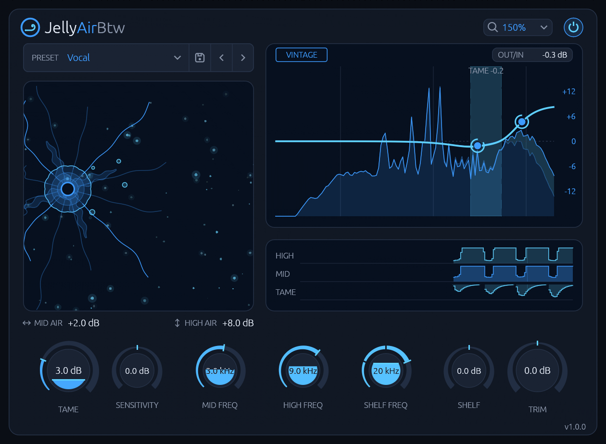

# JellyAirBtw

**An air enhancer that lifts the top of a voice or a mix where it is quiet and backs off where it is already bright,
steered with a jellyfish.** CLAP for Linux.



**[JellyAirBtw on jelly-comet.github.io](https://jelly-comet.github.io/plugins/jellyairbtw/)**: more screenshots, the manual to read or as a PDF, and every release.

JellyAirBtw adds air: the breath of a voice, the shine of strings, the top of a mix. It doesn't turn the treble up
the same everywhere, as a shelf does. Two bands, MID AIR for presence and HIGH AIR for air, add their lift while they
are quiet against the whole signal and less as they get louder, so the vowels, the breaths and a dull passage get the
air, and an s, a cymbal or a bright mix gets much less: with the same air on the vowels of 100 sung takes, an s got
0.7 dB of it where a static shelf gave 4 dB. Drag the jellyfish: across sets MID AIR, up sets HIGH AIR, and bubbles
rise from it while air goes in. The display beside it shows the spectrum with the curve you set and the curve the
music gets now. TAME cuts a harsh presence where it sticks out, a static shelf lifts or tilts the top however loud it
is, and it all plays with no latency. It is not a de-esser or an exciter: it adds no harmonics, only level to the
top where it is missing.

**[Read the manual](manual.md)** for every control and how to use it.

## What it's for

- **Vocal air and breath:** a lift for the breaths and the ends of words that leaves the s's nearly as they were.
- **Presence that doesn't turn harsh:** MID AIR adds presence while TAME cuts a belted note or a harsh guitar where it
  sticks out.
- **Brightening a dull mix:** read against the whole, a dull mix gets more air than a bright one, and a mix's brightest
  moments back off on their own.
- **Acoustic guitar and strings:** the strings' shine over the body.
- **A gentle high shelf for mastering:** a static shelf with its pole up to 40 kHz that tilts the top octaves with no
  corner in the band.

## Features

- **Air that follows the music:** MID AIR (up to +12 dB from 1 to 8 kHz) and HIGH AIR (up to +15 dB from 4 to 16 kHz)
  lift their band fully while it is quiet against the whole signal and less as it gets louder. SENSITIVITY sets where
  they back off.
- **A gain before it changes nothing:** the bands read their level against the whole, so a louder or quieter input
  gets the same air. **VINTAGE** reads them against a fixed level instead, as hardware does.
- **Pauses stay as they were:** in a pause the bands' lift fades out over 20 ms, so a room's hiss isn't lifted.
- **TAME:** a bell at 2.5 to 5.5 kHz that cuts up to 12 dB when the presence sticks out of the whole, within 5 ms.
- **A static shelf:** SHELF lifts or cuts the top by up to 15 dB, its pole at 2.5, 5, 10, 20 or 40 kHz, within 0.7 dB
  of the analog curve up to ±12 dB.
- **No latency:** 0 samples. Everything at 0 passes the input unchanged, to the bit.
- **Click-free:** dragging the pad or a corner over a bass note leaves no ticks; VINTAGE and the power switch
  crossfade.
- **A jellyfish pad and a display you can play:** bubbles rise while air goes in; on the display, drag a band's dot to
  move its corner and its air, and hold the middle button on it to hear only that band's air, or press TAME's column
  to hear what TAME takes off.
- **OUT/IN:** reads how much louder the output is than the input, loudness-weighted; a click takes the difference off
  with TRIM.
- **The last seconds of lift and TAME's cut,** redrawn at once as you turn SENSITIVITY or an air.
- **Light:** 0.18 % of a CPU core at the defaults, stereo at 48 kHz, 0.25 % with the window open, and next to nothing
  on silence.
- **Presets:** six built in beside Init, and your own.
- **Zoom** from 100 to 200 %.
- **No network access and no telemetry.**

## Install

Download the latest version from the [Releases page](https://github.com/jelly-comet/JellyAirBtw-release/releases),
or with these commands:

```bash
curl -LO https://github.com/jelly-comet/JellyAirBtw-release/releases/download/v1.0.0/JellyAirBtw-1.0.0-linux-x86_64.tar.gz
curl -LO https://github.com/jelly-comet/JellyAirBtw-release/releases/download/v1.0.0/JellyAirBtw-1.0.0-linux-x86_64.tar.gz.sha256
sha256sum -c JellyAirBtw-1.0.0-linux-x86_64.tar.gz.sha256 && tar xzf JellyAirBtw-1.0.0-linux-x86_64.tar.gz
cd JellyAirBtw-1.0.0-linux-x86_64
```

Install for your user:

```bash
mkdir -p ~/.clap
rm -f ~/.clap/JellyAirBtw.clap && cp JellyAirBtw.clap ~/.clap/
```

Or for all users:

```bash
sudo mkdir -p /usr/lib/clap
sudo rm -f /usr/lib/clap/JellyAirBtw.clap && sudo cp JellyAirBtw.clap /usr/lib/clap/
```

Removing the old copy first avoids overwriting a file a running host has loaded. Then rescan plugins
in your DAW.

To uninstall:

```bash
rm -f ~/.clap/JellyAirBtw.clap
```

Your presets stay in `~/.local/share/JellyAirBtw/presets/`; delete that folder too if you want them gone.

## Requirements

- Linux x86-64 on a CPU with AVX2 (Intel Core from 2013, AMD from 2015), with glibc 2.31 or newer (Ubuntu 20.04, Debian 11, Fedora 32 and newer)
- A CLAP host. Tried in Bitwig Studio and REAPER.
- X11 or XWayland, and a Vulkan driver for the editor

Releases contain the CLAP plugin only.

## FAQ

### Is it free?

Yes. The download is free and MIT-licensed.

### Is there a VST3 or LV2 version?

No. Releases contain the CLAP plugin only.

### Does it run on ARM, like a Raspberry Pi or Apple Silicon?

No. It needs Linux on x86-64, on a CPU with AVX2.

### Which hosts does it work in?

Any CLAP host. It was tried in Bitwig Studio and REAPER.

### Does it work on Wayland?

Through XWayland. The editor also needs a Vulkan driver.

### Is it a de-esser or an exciter?

Neither. It adds no harmonics, only level to the top where it is quiet, and backs off where the top is already loud,
so an s gets much less air than the vowel around it. TAME cuts a harsh presence, but it isn't a de-esser either.

## License

MIT, see [LICENSE](LICENSE). The licenses of the third-party code in the binaries are in
`THIRD-PARTY-LICENSES.txt` in each release archive.

VST is a registered trademark of Steinberg Media Technologies GmbH. CLAP is an open standard by the
free-audio project. Dolby is a trademark of Dolby Laboratories, Fresh Air of Slate Digital and Air Band of Maag
Audio. JellyAirBtw is an independent project. It isn't affiliated with or endorsed by Steinberg, Dolby, Slate
Digital or Maag Audio, and it contains none of their code.
