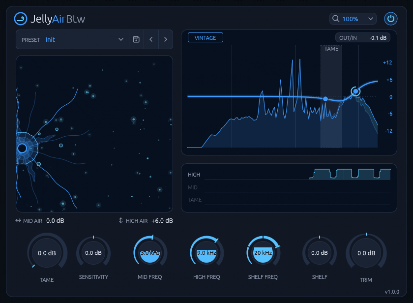
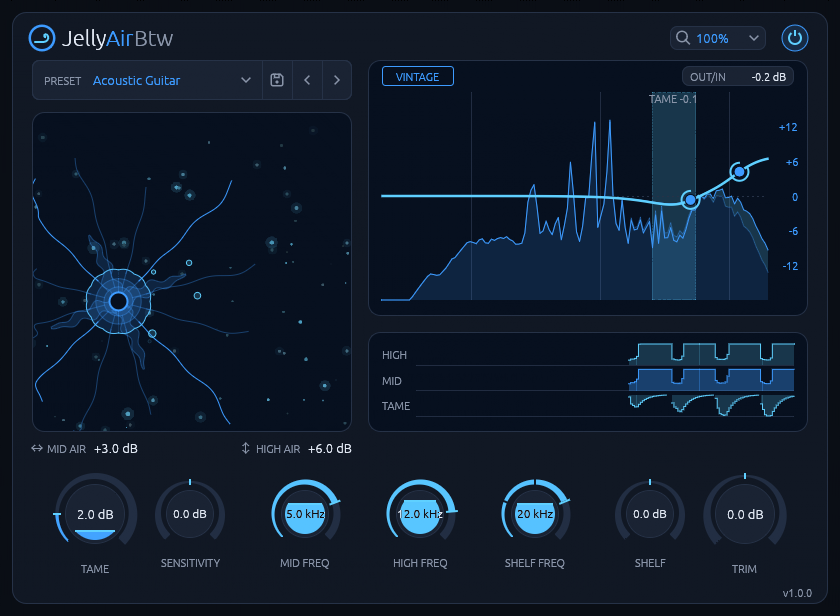

# JellyAirBtw manual

**An air enhancer that lifts the top of a voice or a mix where it is quiet and backs off where it is already bright,
steered with a jellyfish.**

Version 1.0.0. To install it, see the [install steps](README.md#install).

## Contents

- [Getting started](#getting-started)
- [The controls](#the-controls)
- [How to use it](#how-to-use-it)
- [Good to know](#good-to-know)
- [Troubleshooting](#troubleshooting)

## Getting started

Put JellyAirBtw on a vocal, an acoustic instrument or a mix bus, stereo or mono. It opens on Init: HIGH AIR +6 dB
from 9 kHz and nothing else, so the jellyfish sits at the left edge of the pad. Play the track and drag the jellyfish
up for more air, across for more presence. Bubbles rise from it while air goes in, more and faster the more of the
lift you set reaches the sound.

For a vocal, pick the **Vocal** preset from the PRESET list and switch the power button at the top right off and on to
hear the difference. Air adds level, so for a fair comparison click the **OUT/IN** chip at the top right of the display
once: it takes the difference off with TRIM.



## The controls

In the order of the editor, left to right and top to bottom.

| Control | Range | Default | What it does |
| --- | --- | --- | --- |
| Power | on, off | on | At the top right. Off crossfades to the input over 20 ms; on starts the air from silence. |
| Zoom | 100 to 200 %, steps of 25 | 100 % | The window's size, kept with the project. |
| PRESET | a list | Init | See [Presets](#presets). |
| MID AIR | 0 to +12 dB | 0 dB | The jellyfish across, or the lower dot on the display up and down: the presence band's lift while it is quiet against the whole. |
| HIGH AIR | 0 to +15 dB | +6 dB | The jellyfish up, or the higher dot up and down: the air band's lift. The scroll wheel over the pad sets it. |
| VINTAGE | on, off | off | On the display's strip, top left. Reads the bands against a fixed level instead of the whole, so the lift follows the input's level, as hardware does. |
| OUT/IN | a readout | | On the display's strip, top right, not a parameter: how much louder the output is than the input over the last 3 s, loudness-weighted, `–` until a second has played. A click lowers or raises TRIM by it, once. |
| TAME | 0 to 12 dB | 0 dB | The most the presence bell cuts, 2.5 to 5.5 kHz, where it sticks out: a belted note, a harsh guitar. |
| SENSITIVITY | −12 to +12 dB | 0 dB | Where the air backs off: higher lifts more of the time, lower backs off sooner. At 0 each band backs off from its median level on sung voices. |
| MID FREQ | 1 to 8 kHz | 3.0 kHz | Where MID AIR's band starts: the presence it lifts. Its dot on the display moves it sideways. |
| HIGH FREQ | 4 to 16 kHz | 9.0 kHz | Where HIGH AIR's band starts: the air it lifts. Its dot moves it sideways. |
| SHELF FREQ | 2.5, 5, 10, 20, 40 kHz | 20 kHz | Where the static shelf turns. From 10 kHz up it tilts the top octaves, with no corner in the band. |
| SHELF | −15 to +15 dB | 0 dB | A static shelf on top of the air: it lifts or cuts the top however loud it is. |
| TRIM | −12 to +12 dB | 0 dB | The output's level, to match the input's. Presets leave it alone. |

**Mouse:** drag the jellyfish, or press anywhere on the pad to move it there; the scroll wheel over the pad sets HIGH
AIR. On the display, drag a band's dot: sideways it moves the band's corner, up and down its air. Drag a knob, hold
Shift for fine steps, turn the scroll wheel over it, double-click to reset it to its default (on the pad and on a dot,
both values), and right-click a knob to type a value (`3 kHz`, `+4 dB`). Every control shows a one-line tooltip, and
every parameter can be automated by the host.

## How to use it

### The two airs



Both bands are added to the input, each from its corner upwards. Each lifts its band by the full amount while the
band is quiet against the whole signal and by less as it gets louder, so the vowels, the breaths and a dull passage
get the air, and an s, a cymbal or a bright mix gets much less of it.

- **HIGH AIR** (from HIGH FREQ, 4 to 16 kHz) is the air: breath, shine, the very top. Start at +6 to +8 dB from 9 kHz
  on a voice; move HIGH FREQ above 10 kHz to keep it clear of the s's at 5 to 9 kHz.
- **MID AIR** (from MID FREQ, 1 to 8 kHz) is presence. HIGH AIR's band dips the octave under its corner by about
  1 dB, so a little MID AIR (+1 to +2 dB) gives a voice its presence back.
- **SENSITIVITY** sets where the bands back off. Raise it if a quiet or bright source gets too little air; lower it if
  the loud lines or the s's get brighter than you want.

### The display

The display shows the spectrum of what plays, the curve you set and, lit, the curve the music gets now: where the
two part, the air is backing off. Its two dots are the bands' corners: drag one sideways to move the corner, up and
down to set its air.

**Hear one part alone:** hold the middle mouse button (or the left one with Alt) on a dot to hear only the air that
band adds; drag sideways while you hold it to sweep the band as you listen. With TAME above 0, press TAME's column to
hear only what TAME takes off. Let go and the output is as it was. Nothing is saved or automated.

Under the display, three lanes show the last 4.5 s: HIGH's and MID's lift and TAME's cut. The bands' lanes are drawn
at the knobs as they are, so turning SENSITIVITY or an air shows at once how the last seconds would have been lifted.

### TAME

TAME is a bell at about 3.7 kHz that cuts only while the presence, 2.5 to 5.5 kHz, sticks out of the whole: a belted
note, a harsh guitar, a hard consonant. It cuts within 5 ms and lets go over 100 ms. Set the most it may cut, 2 to
3 dB for a voice, up to 6 dB for a harsh one; its lane shows when it works. At 0 it is out of the path.

### The shelf

SHELF is a static shelf after the airs: it lifts or cuts the top however loud it is. With SHELF FREQ at 2.5 or 5 kHz
it is a classic high shelf; from 10 kHz up its pole sits above the corner you hear, so it tilts the top octaves
gently with no bump in the band, the way a mastering air shelf does. Reach for it when a bright source alone gets
little of the airs' lift, since read against the whole, a top that is the whole signal reads as loud.

### VINTAGE

Off, the bands read their level against the whole signal, so a gain before JellyAirBtw changes nothing. On, they read
it against a fixed level, as hardware does: the louder the input, the less air. Use it when you want the air to move
with how hard the track is driven.

### Presets

The PRESET list holds Init (every default), your favourites, the six built-in presets and then your own. The arrows
step through them, the disk saves the current settings under a name, and PRESET reads `Custom` once a setting differs
from every preset. A preset is the air: both airs and their corners, SENSITIVITY, TAME, the shelf and VINTAGE. It
leaves TRIM and the power switch alone, so it changes the air and not the level the track sends.

| Preset | Settings | What it is |
| --- | --- | --- |
| Vocal | MID AIR +2 dB, HIGH AIR +8 dB, TAME 3 dB | Air for the breaths and the ends of words, the s's nearly as they were. |
| Breathy Vocal | HIGH AIR +10 dB at 11 kHz, SENSITIVITY +4 dB | More of the quiet lines, the corner above the s's. |
| Harsh Vocal | HIGH AIR +6 dB, SENSITIVITY −3 dB, TAME 6 dB | No presence added, TAME cutting it where it sticks out, a loud line backing off sooner. |
| Acoustic Guitar | MID AIR +3 dB at 5 kHz, HIGH AIR +6 dB at 12 kHz, TAME 2 dB | The strings' shine over the body. |
| Dull Mix | MID AIR +2 dB, HIGH AIR +8 dB, SHELF +2 dB at 40 kHz | A dull mix gets more than a bright one; the tilt on top. |
| Master | MID AIR +1 dB, HIGH AIR +4 dB, SENSITIVITY −3 dB, TAME 2 dB, SHELF +1 dB at 40 kHz | Gentle, so a master's bright moments back off. |

Your presets are text files in `~/.local/share/JellyAirBtw/presets/`, one `id value` line per parameter (SHELF FREQ
by its step, `2k5` to `40k`, VINTAGE `on` or `off`), shared by every project:

```text
high_air 6
shelf_freq 20k
vintage off
```

A line a file doesn't have leaves its parameter alone, and a line it doesn't know is skipped.

## Good to know

- **No latency:** JellyAirBtw reports 0 samples, so it needs no delay compensation and is fine for live monitoring.
- **Everything at 0 is the input:** both airs, TAME, SHELF and TRIM at 0 pass the input unchanged, to the bit.
- **The lift moves with the music,** a little from moment to moment; that is how it follows the track. A static
  shelf doesn't.
- **Air adds level.** The OUT/IN chip shows how much; one click takes it off with TRIM.
- **Automation:** every parameter can be automated. Moving a corner, the shelf or the pad, even over a bass note,
  leaves no clicks.
- **CPU:** about 0.18 % of a core at the defaults, 0.42 % with TAME on, stereo at 48 kHz; on silence it rests.

## Troubleshooting

- **The plugin doesn't show up:** check that `JellyAirBtw.clap` is in `~/.clap` or `/usr/lib/clap`, then rescan
  plugins in your DAW. It needs a CPU with AVX2.
- **The editor window stays black or doesn't open:** check that a Vulkan driver is installed. The `vulkaninfo` tool
  from `vulkan-tools` should list your GPU.
- **A bright source gets hardly any air:** that is the bands backing off where the top is already loud. Raise
  SENSITIVITY for more of the time, or add SHELF, which lifts however loud the top is.
- **The s's get brighter too:** lower SENSITIVITY, so a loud band backs off sooner, or move HIGH FREQ up, above the
  s's 5 to 9 kHz.
- **The voice loses some presence with HIGH AIR up:** its band dips the octave under its corner by about 1 dB. Add a
  little MID AIR.
- **The air changes when the input gets louder or quieter:** VINTAGE is on. Turned off, the bands read against the
  whole and a gain before the plugin changes nothing.
- **TAME seems to do nothing:** it cuts only while the presence sticks out of the whole. The TAME lane under the
  display shows when it does.
- **The track got louder:** air adds level. Click OUT/IN, or bring TRIM down; presets leave it where it is.
- **Typing a preset's name does nothing:** some hosts keep keystrokes for themselves. Write the preset file by hand
  instead (see [Presets](#presets)).
- **A preset doesn't show up in the list:** its file must end in `.preset`, and its name can't start with a dot or be
  Init's or a built-in preset's. The editor reads the folder when it opens and after a save, so reopen the editor
  after adding files by hand.
